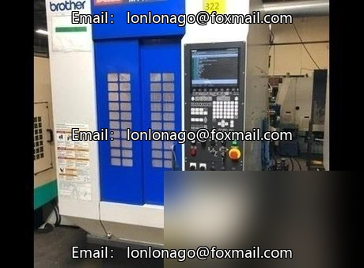
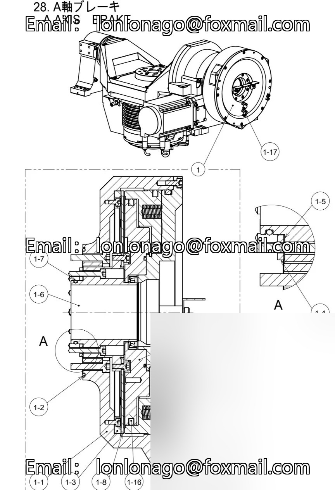
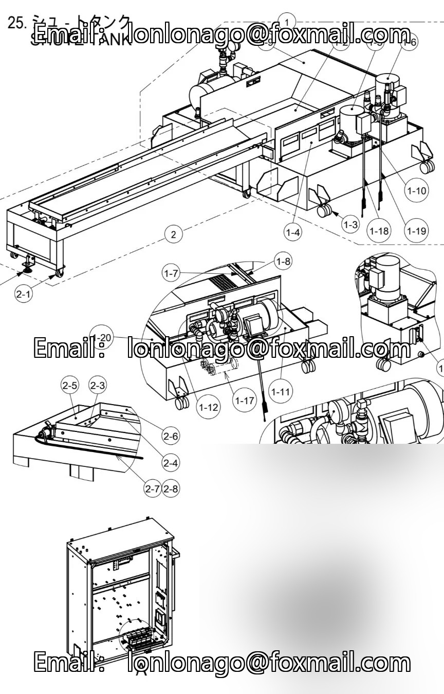
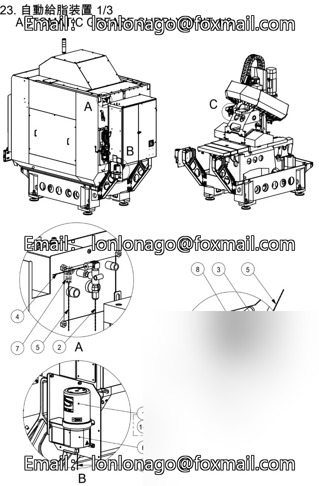
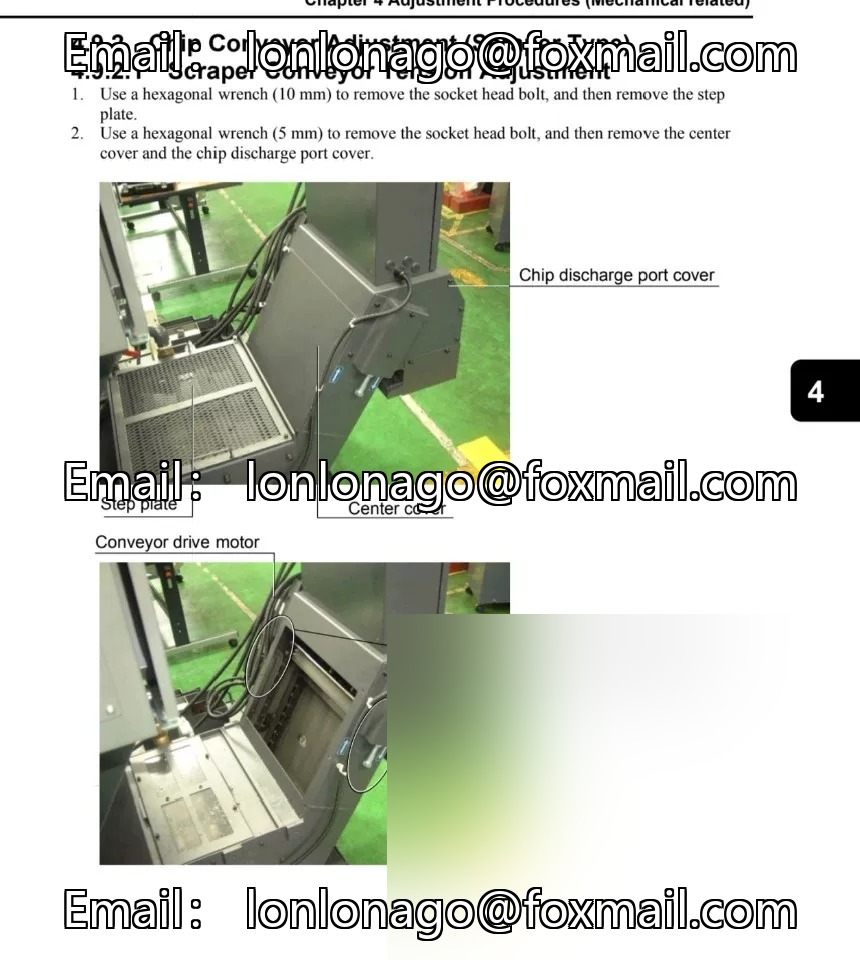
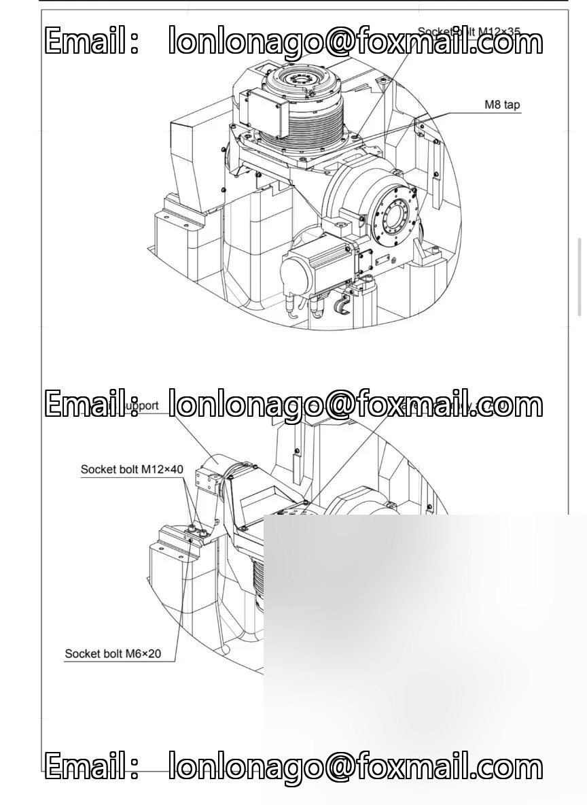
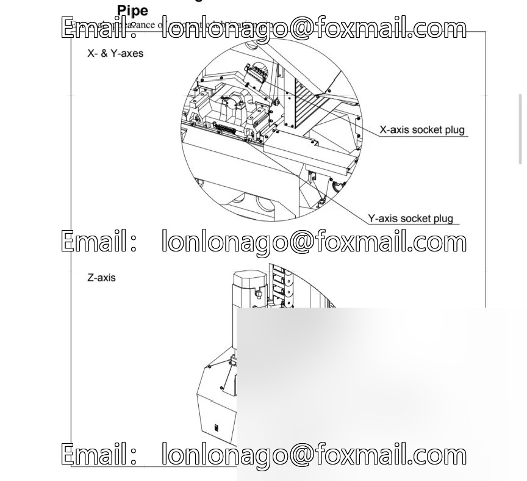
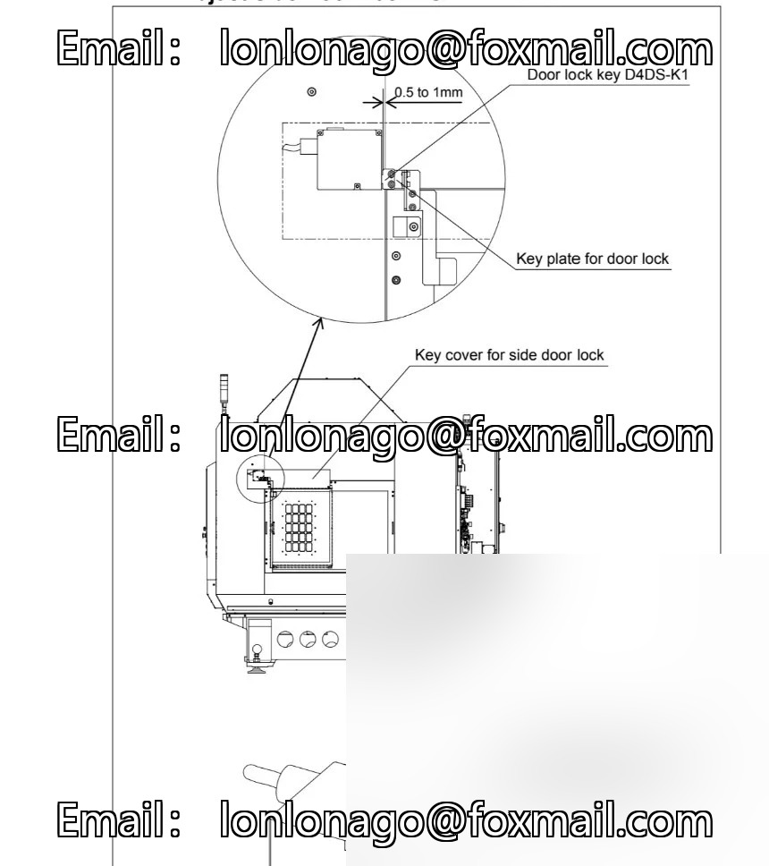
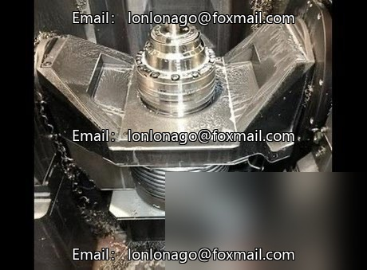

# Brother Industries, Ltd. (Brother Industries, Ltd.)

## Body

Brother Industries, Ltd. (Kisei Kogyo Co., Ltd.) - Reference materials for the M140X2 series equipment released
PDF , 900 pages
Equipment type: SPEEDIO M140X2 is a compact five-axis milling-turning center.
114825
Core application: It is mainly used for high-precision metal cutting and machining, and is commonly used in the production of automotive manufacturing (such as transaxle parts, fuel nozzles), medical devices, aerospace, and electronic precision components.

Technical characteristics: The biggest highlight of this machine tool is "combined turning and milling". It integrates turning and milling functions within a very small space (occupying only about 1.2 square meters), and has added axis B (tilt axis) and axis C (rotary axis), enabling five-axis coordinated machining. Simply put, complex parts that previously required multiple machines and multiple clamping operations can now be completed in a single operation on this machine.

The references cover Brother Industries, Ltd. (Brother Industry Co., Ltd.)'s M140X2 series equipment; the document is PDF900 pages. The device is a compact five-axis mill-turn centre mainly used for high-precision metal cutting and production of automobile parts, medical devices, aerospace and electronic precision components, with characteristics such as composite machining, a footprint of about 1.2 square metres, and five-axis operation.

<!-- AI_ENRICHED -->

## Images

## Payment

Here is a pay link on Stripe ( https://buy.stripe.com/3cs8yP7sY87d0vu9AB ). Please contact me lonlonago@foxmail.com after funding $89, and I will send you a complete data files , thank you!

